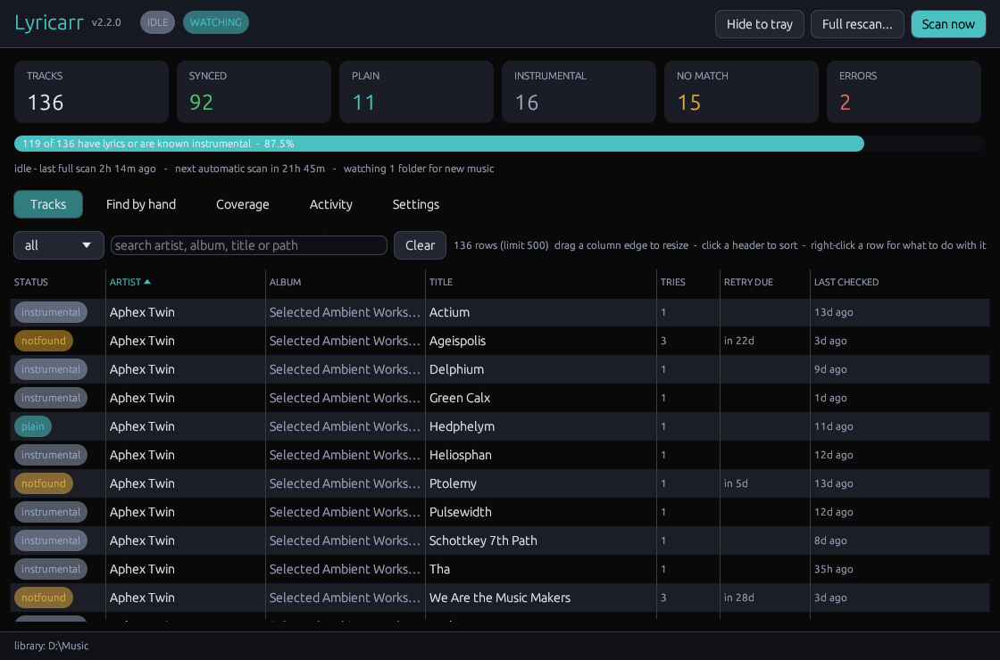
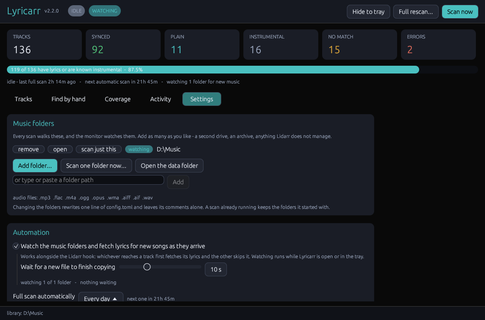
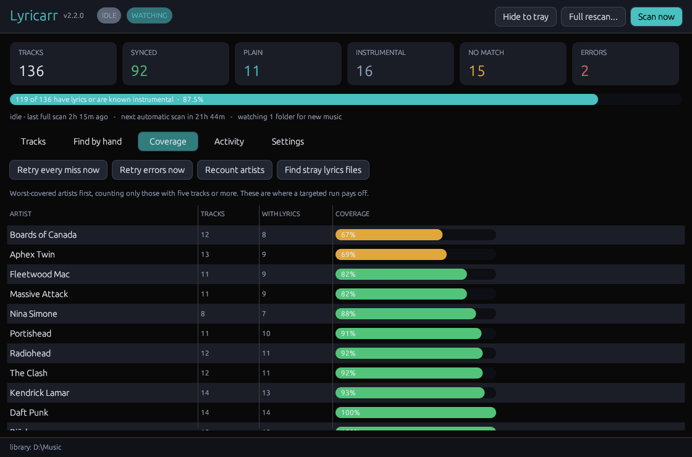

<div align="center">

# 🎤 Lyricarr

**Synced lyrics for your whole music library.**

Walks your [Lidarr](https://lidarr.audio/) library, reads each track's tags, looks it up on [LRCLIB](https://lrclib.net) and writes a timestamped `.lrc` sidecar next to the audio file — so Emby, Jellyfin, Plex, Navidrome and most mobile players just start showing lyrics in time with the music.


</div>

---

## Overview

Lyricarr is a lyrics companion for a [Lidarr](https://lidarr.audio/) library. Lidarr fetches the music — Lyricarr makes sure the words turn up with it.

```
Lidarr  ->  your music folder  ->  Lyricarr  ->  .lrc beside every track
(music)       (the library)        (lyrics)
```

It is **one executable, for Windows or Linux**. The window, the command line, the folder monitor, the Lidarr hook and the scheduled-scan installer are all `lyricarr.exe` on Windows and `lyricarr` on Linux — no runtime to install, no container. Run with no arguments it opens the window; given a subcommand it behaves as a CLI.

**Lyricarr never touches your audio files.** It only writes sidecar files beside them, and it will not overwrite one that already exists unless you ask it to.

## Demo

The video at the top of this page is a 30-second tour of what it does.

## Features

- **Finds lyrics from tags, not filenames** — Lidarr's filenames are mangled (`Artist - Album -  Disc  - 4 - Title.mp3`, empty disc fields, `;`-joined collaborators), so Lyricarr reads the tags instead. In a 60-file sample across the library, 100% had title, artist, album and duration.
- **Timestamped `.lrc` sidecars** — written as `Artist - Album - 01 - Title.lrc` beside `… - Title.flac`, which is the convention Emby, Jellyfin, Plex, Navidrome and Finamp already look for. Nothing to configure in the player.
- **A real matching ladder** — up to three `/api/get` attempts (tags verbatim with album → without album → `(feat. …)` / `(Remastered)` / `(Original Mix)` stripped, primary artist only), then `/api/search` scored on duration, title and artist similarity. Most tracks hit on the first request; the average across a full library is about 1.6 requests per track.
- **Duration is the deciding vote** — `/api/search` will happily return a 32-second "Get Lucky". Candidates outside ±10s are rejected outright, because length is the strongest signal that two entries are the same recording.
- **A relaxed tier for unsynced words** — plain lyrics carry no timestamps, so a radio edit or live cut of a different length still has the right words. If nothing passes the strict gate, a near-exact title and artist match can still supply *plain* lyrics with the duration window widened to 45s. Synced lyrics are **never** accepted this way.
- **Knows the difference between "no lyrics" and "server was busy"** — LRCLIB answers `503 ServerOverloaded` often enough that this matters. A genuine miss is recorded as `notfound` and re-asked on a widening 7/30/90/180-day ladder (LRCLIB grows over time); an unreachable server is recorded as `error` and retried on the very next run. A truncated or non-JSON body on an HTTP 200 counts as an error too.
- **Incremental and resumable** — state lives in SQLite, so a second pass over an unchanged library makes **zero** network requests. Ctrl-C is safe at any point: in-flight tracks finish, progress is committed, and the next run picks up exactly where it stopped.
- **Watches your music folders live** — anything that lands in a music folder gets its lyrics a few seconds after it finishes copying: an album dragged in by hand, a download client writing straight into the library, a folder synced from another machine. It runs alongside the Lidarr hook, not instead of it, and it is a setting you can switch off.
- **Full scans on a schedule** — a full pass every day (or every 6 hours, 12 hours, 3 days, a week, or never) while Lyricarr is running, as the safety net under the live watching. A full pass only costs requests for tracks that are new or due a retry.
- **Full rescan on demand** — one button walks the whole library again and re-asks LRCLIB about every track that still has no lyrics, without waiting out the retry ladder.
- **Desktop window** — coverage tiles (synced / plain / instrumental / no match / errors), live scan state, and a searchable, sortable track table filtered by status. Per-row actions: find lyrics by hand, mark as instrumental, forget it so the next scan re-checks, open the file in a text editor, copy the path, preview, or delete the sidecar.
- **Lives in the tray on Windows** — minimising hides to the notification area. Start a scan, stop one, open the music folder or the log without bringing the window back. `--background` starts it in the tray with no window at all, which is what the sign-in entry uses.
- **Runs in the background on Linux** — the same monitor and automatic scans with no window: started at log-in, or as a systemd user service (`lyricarr install-service`) on a machine with no desktop at all. Open the window whenever you like; it leaves the watching to the background one.
- **Fetches on import** — Lidarr's Custom Script connector calls `lyricarr hook` the moment a track is filed, so new music gets its lyrics immediately rather than waiting for the next sweep. The hook always exits 0; a lyrics problem must never fail a Lidarr import.
- **Scheduled sweeps** — `lyricarr install-task` registers a Windows scheduled task, or a systemd user timer on Linux, as the safety net for anything the hook missed. Weekly at 04:00 by default. Unlike the in-app schedule it runs whether or not Lyricarr is open.
- **Polite by design** — 3 requests/second across 4 workers, a shared backoff so a single `503` slows every worker at once, and `Retry-After` honoured. LRCLIB is free and donation-funded; the defaults are chosen to stay a good neighbour.
- **Housekeeping tools** — find stray `.lrc` files that have no audio beside them, recount artists, edit `config.toml` in place with validation, and reset window or column layout.
- **Upgrades in place** — v2.0.0 is a Rust rewrite of the original Python layout, and it deliberately keeps that version's `config.toml`, `data\lyricarr.db` and `.lrc` output. An existing install's finished work carries straight over instead of being re-fetched from LRCLIB.

## Screenshots

The track list - every track, what came back for it, and what is due a retry:



Settings, with live monitoring and the automatic full scan under Automation:



Coverage - the worst-covered artists first, where a targeted run pays off:



<div align="center">
  
</div>

## Project layout

This repository:

```
├── lyricarr.exe            the whole program on Windows: window, CLI, hook, task installer
├── lyricarr                the same, for Linux
├── config.example.toml     every setting, commented - copy to config.toml, or let the window make one
├── Lidarr-Hook.cmd         what Lidarr's Custom Script connector points at (Windows)
├── Lidarr-Hook.sh          the same, for Linux
├── Cargo.toml / build.rs   the build
├── assets/                 icon + preview image
├── docs/screenshots/       the pictures above
├── .github/workflows/      the Windows + Linux build and tests
└── src/
    ├── main.rs             CLI surface and dispatch
    ├── gui.rs              the window
    ├── tray.rs             notification-area icon and menu (Windows)
    ├── scan.rs             the library walk and worker pool
    ├── watch.rs            live folder monitor (ReadDirectoryChangesW / inotify) and the automatic full scan
    ├── os.rs               what Windows and Linux do differently: locks, start at sign-in, scheduling
    ├── matcher.rs          the variant ladder and scoring
    ├── lrclib.rs           LRCLIB client, rate limiting, backoff
    ├── store.rs            SQLite state
    ├── tags.rs             tag reading (lofty)
    ├── text.rs             normalisation: feat., brackets, artist splitting
    ├── config.rs           config load/validate
    └── tools.rs            stray-file finder, recount, housekeeping
```

Next to the program, once it has run (`~/.local/share/lyricarr/` on Linux):

```
├── config.toml             all settings (TOML, commented in full)
└── data/
    ├── lyricarr.db         SQLite state (WAL) - what has been checked, and when to re-ask
    ├── lyricarr.log        rotating log
    ├── prefs.json          window preferences, including the automation settings
    └── window.ron          egui layout persistence
```

## Quick start

### Windows

Download `lyricarr-windows-x86_64.zip` from the [latest release](../../releases/latest) and unzip it into a folder of its own (`lyricarr.exe` is also in the root of this repository). Put a `config.toml` beside it if you have one - otherwise it makes one the first time you add a music folder - then run it, and add your Lidarr root folder under **Settings → Music folders**. That is all: it starts looking through the folder straight away and watches it from then on.

From PowerShell, for the curious:

```powershell
cd C:\Lyricarr

# Diagnose a single file first - tags, every variant tried, what matched
.\lyricarr.exe check "D:\Music\The Clash\Combat Rock (1982)\The Clash - Combat Rock - 01 - Know Your Rights.flac"

# Try a small batch for real
.\lyricarr.exe scan --limit 50

# Coverage so far
.\lyricarr.exe stats
```

### Linux

One 64-bit binary for any distribution with glibc 2.31 or newer (Ubuntu 20.04+, Debian 11+, Fedora 32+, RHEL 9). Download `lyricarr-linux-x86_64.tar.gz` from the [latest release](../../releases/latest) (the `lyricarr` in the root of this repository is the same file), unpack it, and put the binary on your `PATH`:

```bash
tar xzf lyricarr-linux-x86_64.tar.gz
```

```bash
sudo install -m 755 lyricarr-linux-x86_64/lyricarr /usr/local/bin/lyricarr
```

**With a desktop**, run `lyricarr`, add your music folder in **Settings → Music folders**, and tick **Start when you log in** under Settings → Window, so it keeps watching once the window is closed.

**Without one** (a server, a NAS), tell it where the music is and run it as a service:

```bash
lyricarr add-folder /srv/music
```

```bash
lyricarr install-service
```

```bash
loginctl enable-linger "$USER"
```

The last line keeps the service running while you are logged out. `lyricarr stats` shows how it is getting on, and `journalctl --user -u lyricarr-watch` or `~/.local/share/lyricarr/lyricarr.log` what it has been doing.

Config lives in `~/.config/lyricarr/config.toml` and state in `~/.local/share/lyricarr/`. If there is a `config.toml` (or a `data` folder) beside the binary, Lyricarr uses that folder instead, Windows-style - handy for keeping everything on one drive.

Folder pickers on Linux go through the desktop portal (`xdg-desktop-portal`, standard on GNOME and KDE). Where there is none, type or paste the path into the box under **Add folder...** instead.

### Build from source

Needs a Rust toolchain (stable, 2021 edition) and nothing else: `rusqlite` is built with the `bundled` feature, so there is no SQLite to install, and on Linux the windowing and OpenGL libraries are loaded at run time rather than linked, so no `-dev` packages are needed either.

```powershell
cargo build --release
copy target\release\lyricarr.exe C:\Lyricarr\
```

```bash
cargo build --release
```

Every push is also built and tested on Windows and Linux by GitHub Actions (`.github/workflows/build.yml`); the binaries from each run are under **Actions → the run → Artifacts**. The same workflow publishes releases: push a tag named for the version in `Cargo.toml` (`v2.2.0`), or run it by hand with **release** ticked, and once the build and tests pass it creates the GitHub release from the committed binaries and the CHANGELOG.

## Configuration

Everything lives in `config.toml`, which is commented in full - beside `lyricarr.exe` on Windows, in `~/.config/lyricarr/` on Linux. Paths use TOML **literal** strings (single quotes) so Windows backslashes need no escaping:

```toml
roots = ['D:\Music']      # Windows
roots = ['/srv/music']    # Linux
```

The window's Settings tab and `lyricarr add-folder` both edit this file a line at a time and leave its comments alone.

| Setting | Default | Description |
|---------|---------|-------------|
| `library.roots` | none | Lidarr root folder(s), e.g. `['D:\Music']`. Add more if your library is split |
| `library.audio_extensions` | mp3, flac, m4a, ogg, opus, wma, aiff, aif, wav | What counts as audio |
| `library.skip_dir_names` | recycle bins, `.stversions` | Never descended into |
| `output.plain_lyrics` | `"lrc"` | `"lrc"` writes unsynced words anyway · `"txt"` keeps `.lrc` meaning "synced" · `"skip"` ignores them |
| `output.overwrite` | `false` | `true` replaces sidecars you may have hand-corrected |
| `output.add_id_tags` | `false` | Prepend `[ti:]`/`[ar:]`/`[al:]`/`[length:]` to synced files |
| `output.instrumental_marker` | `false` | Write a marker `.lrc` for instrumentals (the database remembers them either way) |
| `output.min_lyrics_chars` | `20` | Ignore suspiciously short payloads |
| `lrclib.requests_per_second` | `3.0` | Politeness vs speed. Raising it is usually counter-productive |
| `lrclib.workers` | `4` | Concurrent lookups |
| `lrclib.timeout_seconds` | `20` | Per-request timeout |
| `lrclib.max_retries` | `4` | Before a lookup is recorded as `error` |
| `lrclib.duration_tolerance_get` | `5` | LRCLIB's own `/api/get` tolerance measures at about ±5s |
| `lrclib.duration_tolerance_search` | `10` | Hard reject for scored search candidates |
| `lrclib.min_score` | `0.80` | Raise it if you ever see a wrong match |
| `lrclib.min_title_ratio` | `0.72` | Minimum title similarity for a search hit |
| `lrclib.plain_duration_tolerance` | `45` | How far a release length may drift for *unsynced* text |
| `lrclib.plain_min_title_ratio` | `0.90` | The relaxed tier demands a near-exact title |
| `lrclib.plain_min_artist_ratio` | `0.80` | …and a near-exact artist |
| `run.database` | `…\data\lyricarr.db` (Linux: `~/.local/share/lyricarr/lyricarr.db`) | Keep it off the media drive — SQLite on slow spinning storage over a table of a hundred thousand rows is painful |
| `run.log_file` | `…\data\lyricarr.log` (Linux: `~/.local/share/lyricarr/lyricarr.log`) | Rotating log |
| `run.log_level` | `"INFO"` | `DEBUG` logs every match decision |
| `run.progress_seconds` | `15` | How often a scan reports progress |

## How matching works

Accuracy matters more than coverage here: a wrong `.lrc` is worse than none, because it silently desyncs during playback.

1. **`/api/get`**, up to three progressively simpler variants — tags verbatim with the album, then without it (album naming differs wildly between releases), then with `(feat. …)` / `(Remastered)` / `(Original Mix)` stripped and only the primary artist.
2. **`/api/search`** as a fallback, scored on duration (45%), title similarity (35%) and artist similarity (20%). Anything outside ±10s is rejected before scoring.
3. **Relaxed, unsynced only** — a near-exact title and artist can still supply plain lyrics with the window widened to 45s. Synced lyrics never qualify.

Instrumental tracks are recorded as such and never queried again.

### Outcome states

| Status | Meaning | Retried? |
|--------|---------|----------|
| `synced` | Timestamped `.lrc` written | no |
| `plain` | Unsynced lyrics written | no |
| `instrumental` | LRCLIB says the track has no vocals | no |
| `notfound` | Genuinely no match | yes — after 7, 30, 90, then 180 days |
| `error` | Server or network failure; never actually checked | yes — next run |
| `notags` | No usable title/artist tag | no |

## Command line

`lyricarr.exe` on Windows, `lyricarr` on Linux. Global flags can go before or after the subcommand: `lyricarr --quiet scan`.

| Command | What it does |
|---------|--------------|
| `scan` | Incremental pass over the library — the normal mode |
| `scan --limit N` | Stop after N **lookups** (files already done don't count) |
| `scan --dry-run` | Look everything up, write nothing |
| `scan --path DIR` | Restrict to one folder or file (repeat for several) |
| `scan --paths-from FILE` | Scan the folders/files listed in a text file, one per line |
| `scan --force` | Re-check every file, ignoring saved state |
| `scan --retry-now` | Ignore retry windows and re-ask about past misses |
| `scan --skip-embedded` | Leave files that already carry lyrics in their tags |
| `stats` | Coverage report from the state database |
| `add-folder DIR` | Add a music folder to `config.toml`, creating it if need be |
| `watch` | The folder monitor and automatic scans with no window, until stopped |
| `retry --status notfound` | Clear retry windows so the next scan tries them again |
| `check FILE` | Diagnose one file: tags, variants tried, what matched |
| `hook` | Called by Lidarr's Custom Script connector |
| `install-task` | Register the weekly scheduled scan: a scheduled task on Windows, a systemd user timer on Linux (`--schedule Daily\|Weekly`, `--time HH:MM`, `--remove`) |
| `install-service` | Linux: run `watch` as a systemd user service (`--remove`) |
| `stop` | Ask a running scan to stop cleanly |
| `gui` | Open the window (the default with no arguments) |

Global: `--config <path>`, `--quiet`, `--background`.

## Lidarr hook

The scheduled sweep is the safety net; the hook is what makes new music get lyrics *immediately*. In **Lidarr → Settings → Connect → + → Custom Script**:

- **Path:** `C:\Lyricarr\Lidarr-Hook.cmd` on Windows, or the full path to `Lidarr-Hook.sh` on Linux (kept beside the `lyricarr` binary, and executable: `chmod +x Lidarr-Hook.sh`)
- **Tick:** On Release Import, On Upgrade, On Rename, On Track Retag

Lidarr passes the affected paths in `lidarr_addedtrackpaths` (pipe-separated), `lidarr_trackfile_path` and `lidarr_trackfile_paths`; the hook reads them itself, so no arguments are needed. If none are present it falls back to scanning `lidarr_artist_path`.

Two details worth knowing:

- **On Release Import does not fire for a Manual Import** unless *Replace Existing Files* is ticked. On Track Retag fires on any tag write, so ticking it covers manual imports too.
- The hook **always exits 0**. A lyrics problem must never mark a Lidarr import as failed.
- It **never holds up the import**. On Windows `cmd.exe` does not wait for `lyricarr.exe`; on Linux `Lidarr-Hook.sh` starts the lookup detached for the same reason.
- If Lidarr runs **in Docker**, the paths it passes are the container's (`/music/...`), so Lyricarr has to see the music at the same path - or rely on the folder monitor, which watches the real folders and needs no hook at all.

Click **Test** in Lidarr to confirm; it should report success.

## Live monitoring and automatic scans

All of this is under **Settings → Automation** in the window, and all of it is on by default.

- **Watch the music folders** — every music folder is watched with the system's own change notifications (`ReadDirectoryChangesW` on Windows, inotify on Linux), so it costs nothing while nothing is happening. A new file is looked up once it has been left alone for a few seconds (10 by default, adjustable), has stopped growing, and can be opened — a track that is still being copied is never read half-written, because a lookup made with the wrong duration would either miss or match a different cut. A folder moved in all at once is walked as a whole once everything inside it has settled.
- **Alongside the Lidarr hook** — keep the hook. The two do the same targeted lookup, so whichever reaches a track first fetches its lyrics and the other finds it done and skips it.
- **Full scan automatically** — the safety net under the watching: it finds music added while Lyricarr was closed or while a drive was disconnected, and re-asks about misses once their retry time is up. It counts from the last *full* scan, so new music arriving every day does not keep postponing it.
- **Catch up when Lyricarr starts** — an incremental scan at start-up, for anything that arrived while it was closed.

Monitoring runs while Lyricarr is open, in the tray (Windows) or in the background (Linux), so turn on **Start with Windows** / **Start when you log in** if you want it there after every restart. Only one Lyricarr watches at a time: open the window while the background service runs and the window leaves the watching to the service (the pill says `WATCHED IN BACKGROUND`), taking over if the service stops. The pill next to the scan status in the title bar shows what it is doing — `WATCHING`, `3 ARRIVING`, `CHECKING 12 NEW`, or `1 FOLDER OFFLINE` for a drive that is not reachable — and clicking it opens the settings. The Activity tab logs every track it looks up.

Things it handles for you:

- A drive or share that disappears is retried every 30 seconds, and checked over once it is back in case anything changed while it was away.
- More changes at once than Windows can report individually (a whole discography dropped in) falls back to walking that music folder, which only costs lookups for what is actually new.
- Lyricarr's own `.lrc` / `.txt` writes, cover art, and anything in `skip_dir_names` are ignored.
- **Windows:** ejecting a USB drive works while it is being watched - Lyricarr lets go of the folder when Windows asks, and picks it up again when the drive is back.
- **Linux:** inotify needs one watch per folder. Recent kernels allow plenty, but an older system may stop at 8,192; Lyricarr then says `PARTLY WATCHED` and how to raise the limit (`sudo sysctl fs.inotify.max_user_watches=524288`, plus a line in `/etc/sysctl.d/` to keep it). Also, on a network share (NFS, SMB) inotify only hears about changes made *on the machine Lyricarr runs on* - music written to the share by another computer waits for the automatic full scan.

## Scheduling

```powershell
.\lyricarr.exe install-task                               # Weekly, Sundays 04:00
.\lyricarr.exe install-task --schedule Daily --time 03:30
.\lyricarr.exe install-task --remove
```

On Windows, run it from an elevated prompt if you want the task to fire while you are logged out; unelevated it registers a task that runs only while logged on.

On Linux the same commands write `lyricarr-scan.timer` and `lyricarr-scan.service` to `~/.config/systemd/user/` and enable the timer. `Persistent=true` means a run missed while the machine was off happens when it is next on. `loginctl enable-linger "$USER"` lets it run while you are logged out.

### The background service (Linux)

```bash
lyricarr install-service           # ~/.config/systemd/user/lyricarr-watch.service, started now and at every boot
systemctl --user status lyricarr-watch
lyricarr install-service --remove
```

It runs `lyricarr watch`: the folder monitor and the automatic full scans, using the window's settings (it picks up changes to them within a few seconds). `systemctl --user stop` lets any lookups in flight finish first.

## Data & backups

Everything Lyricarr knows lives in `data\lyricarr.db` (Linux: `~/.local/share/lyricarr/lyricarr.db`) — a SQLite database in WAL mode. **Deleting it loses only bookkeeping, never lyrics**: the `.lrc` files are the real output, and a fresh scan simply skips any track that already has one.

Worth knowing if you script against it: the database is written by scans *and* by the Lidarr hook, which can fire at the same time. Writes are committed on a short timer rather than in large batches, precisely so a running scan cannot lock the hook out.

## Performance

Measured on a large library (well over 100,000 tracks, mostly mp3 and flac, in tens of thousands of folders):

| Territory | Requests/track | Retry rate | Throughput |
|-----------|----------------|------------|------------|
| Well-covered (mainstream) | ~1.6 | ~35% | ~0.9 tracks/s |
| Poorly-covered (electronic, underground) | ~4 | ~48% | ~0.2 tracks/s |

A full directory walk alone takes about 6.5 minutes on spinning storage. **A first full pass is a multi-day job** — a miss costs three or four requests instead of one and draws more throttling, so the stretches with the fewest lyrics available are also the slowest to get through.

Coverage looks alarming early and then recovers: the walk is alphabetical, and a library that opens with DJ mixes and instrumental techno will score badly before it reaches anything mainstream. One early stretch scored 44 misses in 47 tracks; a mainstream stretch scored 393 hits in 400. **Expect roughly 70% library-wide**, about two-thirds of it synced. Judge coverage at the end, not at hour one.

Once the library is covered, later runs cost nothing for tracks already done — a weekly sweep only pays for new music.

## Tech stack

- **Language:** Rust 2021, single Windows binary (`lto`, `codegen-units = 1`, stripped)
- **Monitoring:** `ReadDirectoryChangesW` with overlapped I/O through `windows-sys`; inotify through `libc` on Linux
- **Linux:** XDG paths, an XDG autostart entry for "start when you log in", systemd user units for the timer and the service
- **UI:** `eframe` / `egui` 0.29 with `tray-icon`, `rfd` native folder picker, Win32 via `windows-sys`
- **Storage:** `rusqlite` (bundled SQLite, WAL)
- **Tags:** `lofty` · **HTTP:** `ureq` · **Walk:** `jwalk` · **CLI:** `clap`
- **External:** [LRCLIB](https://lrclib.net) — no API key, no account

## Security and privacy

- **The only thing Lyricarr talks to is LRCLIB**, over HTTPS with the certificate checked. No account, no API key, no telemetry, nothing else on the network.
- **It never modifies audio files.** It writes `.lrc` / `.txt` sidecars beside them - never over an existing one unless `overwrite = true` - and its own `config.toml`, `prefs.json`, database, log and lock files in its data folder. Sidecar names come from the audio file's own name, never from anything LRCLIB sends back.
- **No administrator rights, no system changes you did not ask for.** Starting at sign-in (a per-user `Run` value on Windows, an autostart entry on Linux), the scheduled task / systemd timer and the Linux service each exist only after you switch them on, and each switches off again from the same place.
- **Paths are escaped for wherever they go.** A folder or install path ends up inside PowerShell, a systemd unit, a desktop entry and `config.toml`; each has its own quoting, a path that cannot be written safely (a line break in it) is refused rather than written half-right, and the scheduled task's `--schedule` / `--time` are checked before use. These are covered by tests.
- **The database is only ever queried with parameters**; the one piece of SQL built from a choice in the window (the sort column) comes from a fixed list.

## A note on the source

LRCLIB is free, community-maintained and donation-funded, with no API key and no rate-limit headers. The default 3 req/s with shared backoff on `503` is meant to keep Lyricarr a good neighbour — please don't crank it up for a one-off speed run, and consider donating if this saves you time.

If you find a bad entry, the data is community-maintained: reporting it upstream fixes it for everyone.

## Contributing

Issues and pull requests are welcome. For larger changes, please open an issue first to discuss what you'd like to change.

## License

Released under the [PolyForm Noncommercial License 1.0.0](LICENSE). You may use, change and share
Lyricarr for any noncommercial purpose (personal use, hobby projects, research, charities, schools
and similar), but you may not sell it or use it commercially.
